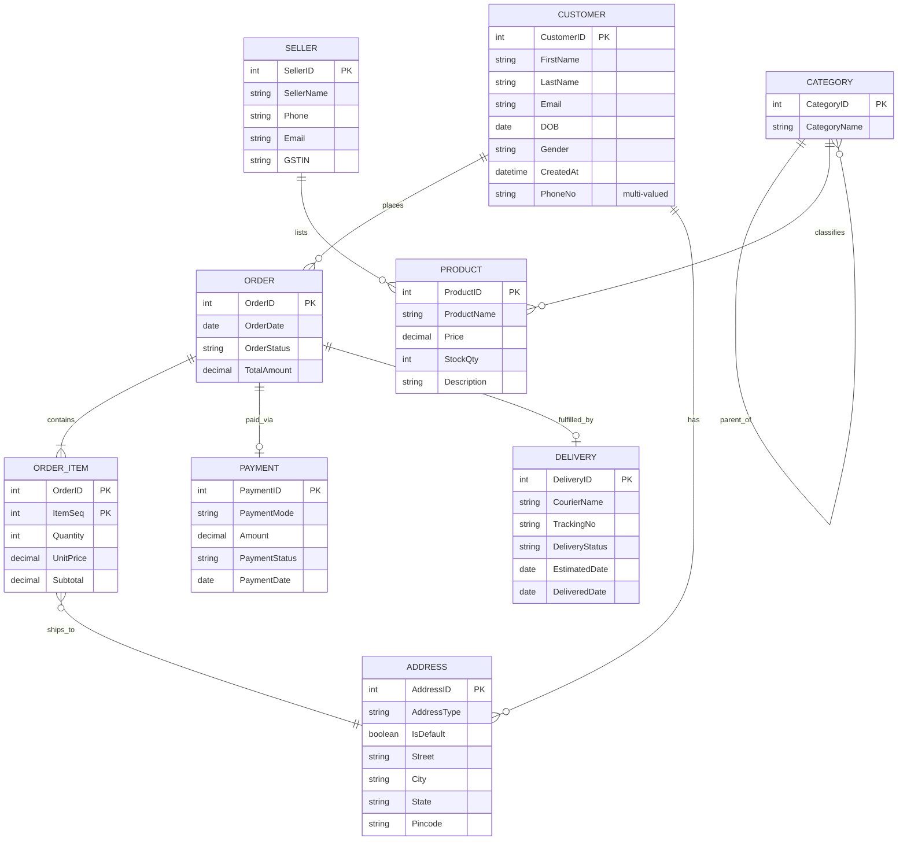

# 🛒 Experiment 1: ER Diagram for an Indian E-Commerce Platform

> A conceptual database design (Entity-Relationship model) for an Indian e-commerce platform, covering customers, sellers, products, orders, payments and deliveries.

---

## 📌 Problem Statement

Design an ER diagram for an Indian E-commerce platform with the entities **Customer, Product, Order, OrderItem, Seller, Category, Payment, Delivery** and **Address**.

The design must specify:

- Primary keys
- Composite and multi-valued attributes
- Weak entities
- Specialization of Product
- Participation constraints

---

## 📖 About ER Diagrams

An **Entity-Relationship (ER) diagram** is a conceptual representation of a database. It shows entities, their attributes, the relationships between them, and the constraints on those relationships.

### Notation Used

| Symbol | Shape | Meaning |
|:------:|-------|---------|
| ▭ | Rectangle | Entity |
| ▭▭ | Double rectangle | Weak entity |
| ⬭ | Ellipse | Attribute |
| ⬭⬭ | Double ellipse | Multi-valued attribute |
| ⬭ (dashed) | Dashed ellipse | Composite attribute |
| ◇ | Diamond | Relationship between entities |
| ― | Line | Connects attributes to entities, and entities to relationships |
| ═ | Double line | Total (mandatory) participation |

---

## 🧩 1. Entities and Primary Keys

| Entity | Primary Key | Other Attributes |
|--------|-------------|------------------|
| **Customer** | `CustomerID` | Email, DOB, Gender, CreatedAt, CustomerName *(composite)*, PhoneNo *(multi-valued)* |
| **Address** | `AddressID` | AddressType, IsDefault, DeliveryAddress *(composite)* |
| **Order** | `OrderID` | OrderDate, OrderStatus, TotalAmount |
| **OrderItem** *(weak)* | `(OrderID, ItemSeq)` | Quantity, UnitPrice, Subtotal |
| **Product** | `ProductID` | ProductName, Price, StockQty, Description |
| **Seller** | `SellerID` | SellerName, Phone, Email, GSTIN |
| **Category** | `CategoryID` | CategoryName |
| **Payment** | `PaymentID` | PaymentMode, Amount, PaymentStatus, PaymentDate |
| **Delivery** | `DeliveryID` | CourierName, TrackingNo, DeliveryStatus, EstimatedDate, DeliveredDate |

---

## 🔗 2. Relationships

| # | Relationship | Description | Cardinality |
|---|--------------|-------------|:-----------:|
| 1 | Customer **PLACES** Order | A customer can place many orders; each order belongs to exactly one customer | 1 : N |
| 2 | Customer **HAS** Address | A customer can have multiple addresses | 1 : N |
| 3 | Order **CONTAINS** OrderItem | An order contains one or more order items; OrderItem depends on Order | 1 : N |
| 4 | OrderItem **SHIPS TO** Address | An order item / order is associated with a delivery address | N : 1 |
| 5 | Seller **LISTS** Product | A seller can list many products | 1 : N |
| 6 | Category **PARENT OF** Category | Categories can have sub-categories, forming a hierarchy (recursive) | 1 : N |
| 7 | Category — Product | Products are classified under categories | 1 : N |
| 8 | Order **PAID VIA** Payment | An order is associated with a payment | 1 : 1 |
| 9 | Order **FULFILLED BY** Delivery | An order is associated with a delivery | 1 : 1 |

---

## 🧱 3. Composite Attributes

A composite attribute can be divided into smaller, meaningful attributes.

| Composite Attribute | Components |
|---------------------|------------|
| `CustomerName` | FirstName + LastName |
| `DeliveryAddress` | Street + City + State + Pincode |

> Shown using a **dashed oval** connected to its component attributes.

---

## 🔢 4. Multi-Valued Attributes

A multi-valued attribute can hold more than one value for the same entity.

- **PhoneNo** of Customer: a customer can have multiple phone numbers.
- **TrackingNo**: represented as multi-valued in the given diagram.

> Shown using a **double oval**.

---

## 🧷 5. Weak Entity

**OrderItem** is a weak entity because it cannot be uniquely identified without its related Order.

| Property | Value |
|----------|-------|
| Owner entity | `Order` |
| Partial key | `ItemSeq` |
| Composite primary key | `(OrderID, ItemSeq)` |
| Identifying relationship | `CONTAINS` |

> Shown using a **double rectangle**, with the partial key underlined with a dashed line.

---

## 📏 6. Participation Constraints

Participation specifies whether the existence of an entity in a relationship is **mandatory** or **optional**.

- **Double line** → Total participation (mandatory)
- **Single line** → Partial participation (optional)
- **1** → One, **N** → Many

**Example:** Every Order must be associated with a Customer (total participation), while a Customer may place zero or many Orders (partial participation).

---

## 🗺️ ER Model Overview (Mermaid)

---

## ✅ Summary of Design Features

| Concept | Where it is used |
|---------|------------------|
| Primary keys | Every strong entity (`CustomerID`, `OrderID`, `ProductID`, ...) |
| Composite attributes | `CustomerName`, `DeliveryAddress` |
| Multi-valued attributes | `PhoneNo`, `TrackingNo` |
| Weak entity | `OrderItem` (owner: `Order`) |
| Recursive relationship | `Category` PARENT OF `Category` |
| Participation constraints | Double line (total) vs single line (partial) |

---

## 🛠️ Tools

- Hand-drawn ER diagram (Chen notation)
- Mermaid (for the digital diagram in this README)

---

## 👤 Author

**Experiment 1** — Database Management Systems (DBMS) Lab
